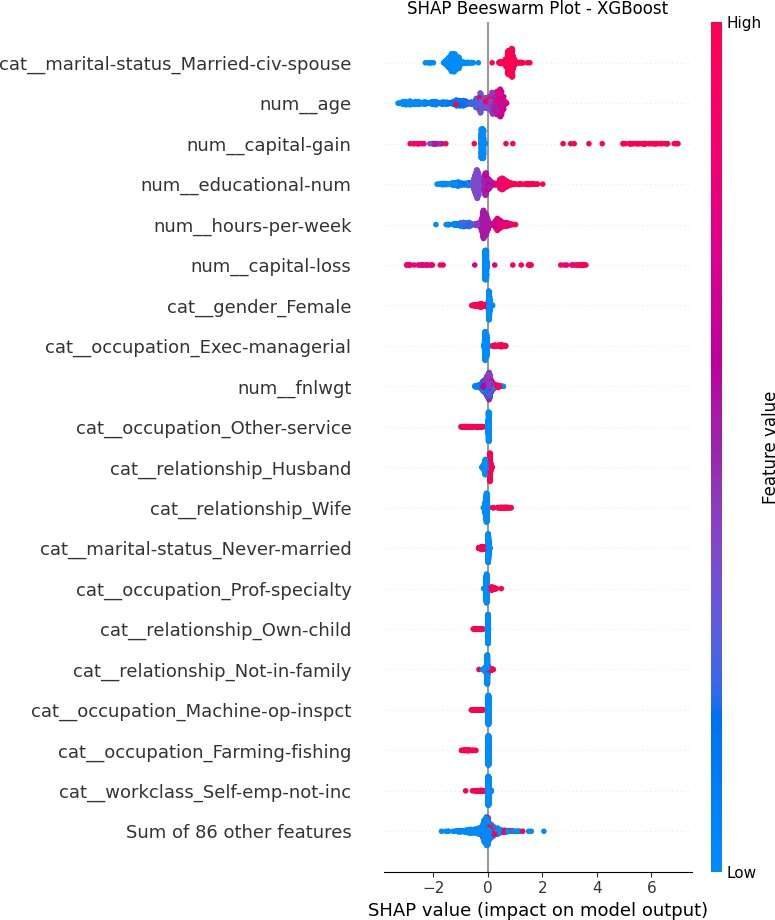
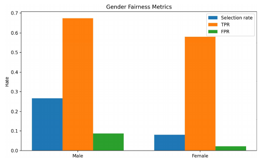
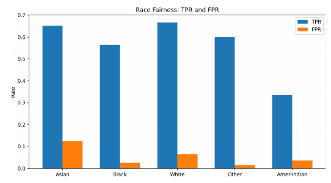
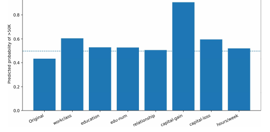

# Explainable Income Prediction (Adult Income): SHAP, Fairness and Counterfactuals

An explainable-AI study on the UCI Adult Income dataset. Five classifiers are compared, the best one (XGBoost) is explained with SHAP, checked for group disparities in gender and race, and probed with a custom counterfactual search.

Done as a remote research internship at IIIT Kota (Dept. of CSE), Jun to Aug 2026, supervised by Dr. Gyan Singh Yadav.

## Pipeline
| Step | Script | What it does |
|---|---|---|
| 1 | `src/01_data_understanding.py` | Overview, hidden missing values (`?`), duplicates, distributions, income by gender and race |
| 2 | `src/02_data_preprocessing.py` | Removes duplicates, stratified **80:20 split** (random_state 42), median/most-frequent imputation, scaling and one-hot encoding in a `ColumnTransformer` (105 features after encoding) |
| 3 | `src/03_model_training_and_evaluation.py` | Trains Logistic Regression, SVM (RBF), Decision Tree, Random Forest and XGBoost as full pipelines |
| 4 | `src/04_model_comparison.py` | Compares the models and checks XGBoost predictions |
| 5 | `src/05_shap_xai_fairness_counterfactuals.py` | SHAP (local and global), fairness metrics by group, counterfactual search |

After de-duplication, the data has 48,790 rows: **39,032 train and 9,758 test**.

## Model comparison (test set, positive class: income > 50K)
| Model | Accuracy | Precision | Recall | F1 | ROC-AUC |
|---|---|---|---|---|---|
| Logistic Regression | 0.8477 | 0.7258 | 0.5848 | 0.6477 | 0.9020 |
| SVM (RBF) | 0.8541 | 0.7536 | 0.5801 | 0.6555 | 0.8962 |
| Decision Tree | 0.8539 | 0.7484 | 0.5869 | 0.6579 | 0.9019 |
| Random Forest | 0.8571 | 0.7820 | 0.5591 | 0.6520 | 0.9131 |
| **XGBoost** | **0.8721** | 0.7725 | **0.6601** | **0.7119** | **0.9268** |

The test set has 9,758 rows (7,422 earning <= 50K, 2,336 earning > 50K). XGBoost is the best on every metric except precision (Random Forest is highest there), so it is the model explained below. Its confusion matrix is: 6,968 true negatives, 454 false positives, 794 false negatives, 1,542 true positives. Because the classes are imbalanced, recall and F1 matter more than accuracy here.

## Explainability (SHAP)
- **TreeExplainer** on all test samples, in the 105-column transformed space, plus SHAP values aggregated back to the 14 original variables (`results/xgboost_shap_original_features.csv`).
- **Beeswarm plot:** the strongest drivers are being married (`marital-status_Married-civ-spouse`), age, capital gain, years of education (`educational-num`), hours per week and capital loss. Age, education and hours show monotone-looking effects; capital gain is mostly near zero with a few large positive contributions.



- **Additivity check:** SHAP values plus the base value reproduce the XGBoost margin output to within 3.8e-6 (maximum) and 4.5e-7 (mean).
- **LIME** was used only to understand local surrogate explanations while learning the methods; it is not part of the final pipeline.
- SHAP describes how the trained model behaves. It does not show that changing a feature would change a person's real income.

## Fairness (equality of opportunity)
Following Hardt, Price and Srebro (2016), group-wise selection rate, true-positive rate (TPR) and false-positive rate (FPR) were computed for the XGBoost predictions.

| Gender | n | Actual > 50K | Predicted > 50K | TPR | FPR |
|---|---|---|---|---|---|
| Male | 6,526 | 0.3065 | 0.2663 | 0.6735 | 0.0864 |
| Female | 3,232 | 0.1040 | 0.0798 | 0.5804 | 0.0218 |

| Race | n | Positives | Actual > 50K | Predicted > 50K | TPR (95% Wilson CI) | FPR |
|---|---|---|---|---|---|---|
| White | 8,376 | 2,120 | 0.2531 | 0.2170 | 0.667 (0.65-0.69) | 0.0646 |
| Asian-Pac-Islander | 291 | 89 | 0.3058 | 0.2852 | 0.652 (0.55-0.74) | 0.1238 |
| Black | 923 | 108 | 0.1170 | 0.0888 | 0.565 (0.47-0.65) | 0.0258 |
| Other | 75 | 10 | 0.1333 | 0.0933 | 0.600 (0.31-0.83) | 0.0154 |
| Amer-Indian-Eskimo | 93 | 9 | 0.0968 | 0.0645 | 0.333 (0.12-0.65) | 0.0357 |

Largest between-group gaps: gender 0.1865 (selection rate), 0.0931 (TPR), 0.0646 (FPR); race 0.2207 (selection rate), 0.3336 (TPR), 0.1084 (FPR).




**How to read this:** the gender gap in selection rate is large partly because the groups have different base rates (30.7% vs 10.4% earn > 50K). The headline race TPR gap (0.33 vs 0.67) comes from the Amer-Indian-Eskimo group, which has only **9** positive cases in the test set (TPR = 3/9, 95% interval 0.12-0.65). That estimate is far too noisy to support a firm conclusion. The intervals above are computed from the group counts; they are not part of the original notebook. Gender and race are also input features of the model, so this is an audit, not a fair model.

## Counterfactual explanations
Following Wachter, Mittelstadt and Russell (2017), a custom search asks which hypothetical change would flip a rejected case. For one false-negative test example (actual > 50K, predicted <= 50K, P(>50K) = 0.4356; a 34-year-old married man in local government, Some-college, executive-managerial, 45 hours per week, no capital gain), it changes **one actionable feature at a time** and records the first tested value at which the XGBoost pipeline's probability crosses **0.5**. Age, fnlwgt, marital status, race, gender and native country are never changed.

| Feature | Original | Changed to | P(> 50K) |
|---|---|---|---|
| workclass | Local-gov | Private | 0.6049 |
| education | Some-college | Bachelors | 0.5310 |
| educational-num | 10 | 12 | 0.5291 |
| relationship | Husband | Wife | 0.5080 |
| capital-gain | 0 | 3103 | 0.9035 |
| capital-loss | 0 | 1485 | 0.5965 |
| hours-per-week | 45 | 84 | 0.5221 |



These are responses of the model, not recommendations: several of the "changes" are not realistic (84 hours a week, a positive capital loss) or are internally inconsistent (relationship changed to Wife while gender stays Male; education changed without educational-num, and the reverse).

## Limitations
- The counterfactual search is a simple one-feature-at-a-time heuristic. It returns the first tested value that crosses 0.5, **not** the smallest or most plausible change, and was run on a single false-negative example.
- `education` and `educational-num` encode the same information.
- Fairness estimates for small groups (Amer-Indian-Eskimo, Other) are unreliable; no fairness-aware training or mitigation was applied.
- One stratified 80:20 split and one run: no cross-validation, no hyperparameter tuning, no confidence intervals on the model metrics.
- The Adult data is a historical benchmark and may not describe current populations. SHAP and counterfactuals describe the model, not causes.

## Reproduce
```bash
pip install -r requirements.txt
mkdir -p data/raw data/processed models results figures
# put the Adult Income CSV (with columns such as educational-num, gender, income) at data/raw/adult.csv
python src/01_data_understanding.py
python src/02_data_preprocessing.py
python src/03_model_training_and_evaluation.py
python src/04_model_comparison.py
python src/05_shap_xai_fairness_counterfactuals.py
```
The scripts were exported from Colab notebooks. They read and write inside the current folder (override with the `XAI_PROJECT_PATH` environment variable) and expect `data/`, `models/`, `results/` and `figures/` to exist.

## References
1. M. Hardt, E. Price and N. Srebro, "Equality of Opportunity in Supervised Learning," *NeurIPS*, 2016.
2. M. T. Ribeiro, S. Singh and C. Guestrin, "'Why Should I Trust You?': Explaining the Predictions of Any Classifier," *KDD*, 2016.
3. S. M. Lundberg and S.-I. Lee, "A Unified Approach to Interpreting Model Predictions," *NeurIPS*, 2017.
4. S. Wachter, B. Mittelstadt and C. Russell, "Counterfactual Explanations Without Opening the Black Box: Automated Decisions and the GDPR," *Harvard Journal of Law & Technology*, 31(2), 2018.
5. B. Becker and R. Kohavi, Adult, UCI Machine Learning Repository, 1996.

## License
MIT. See `LICENSE`.
